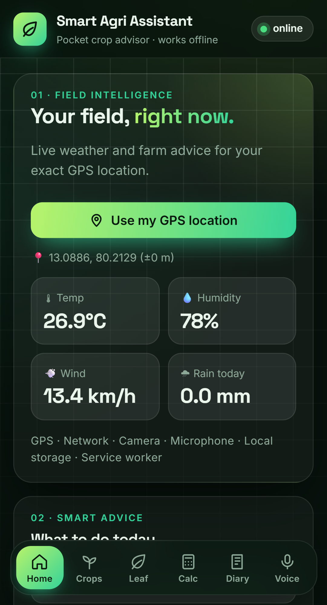
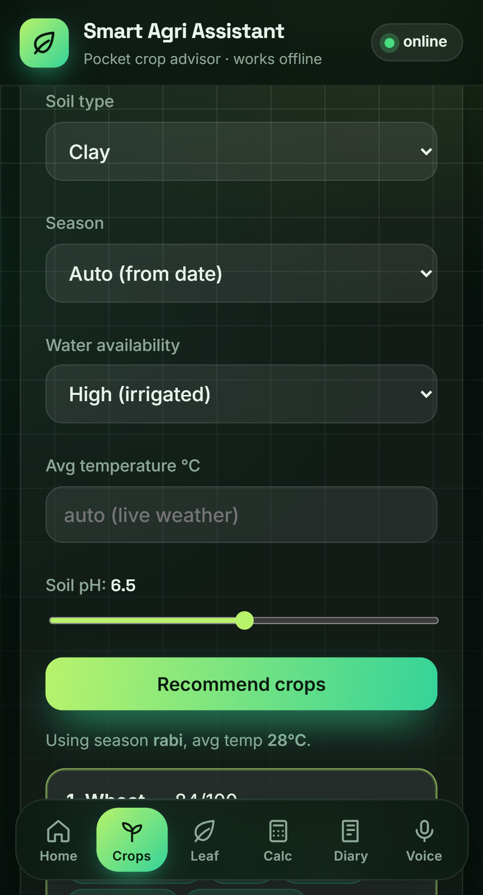
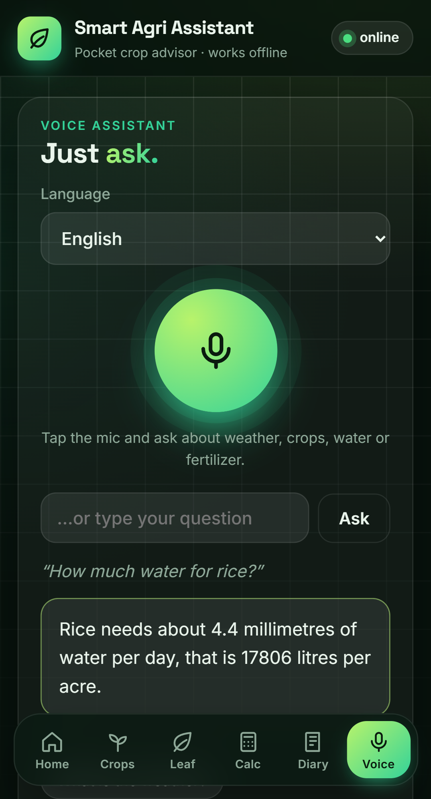
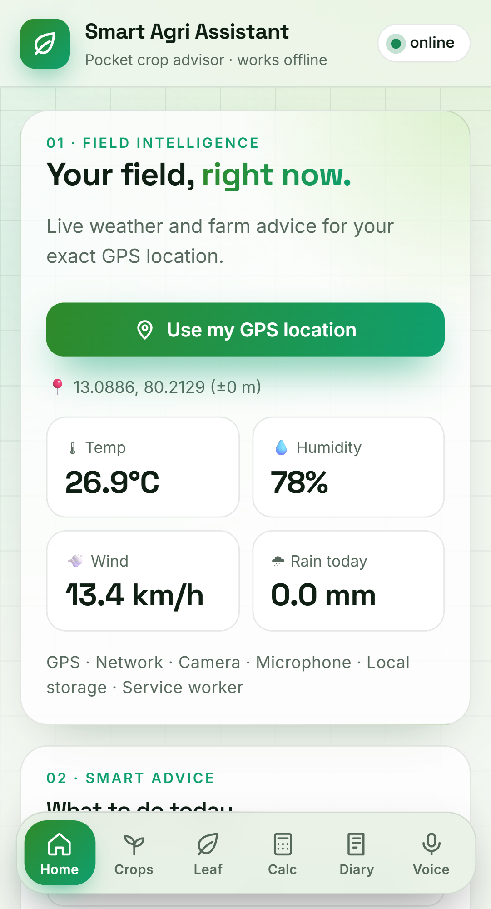
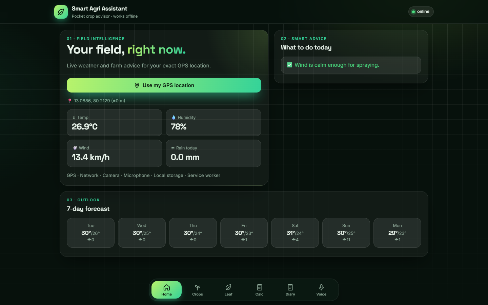
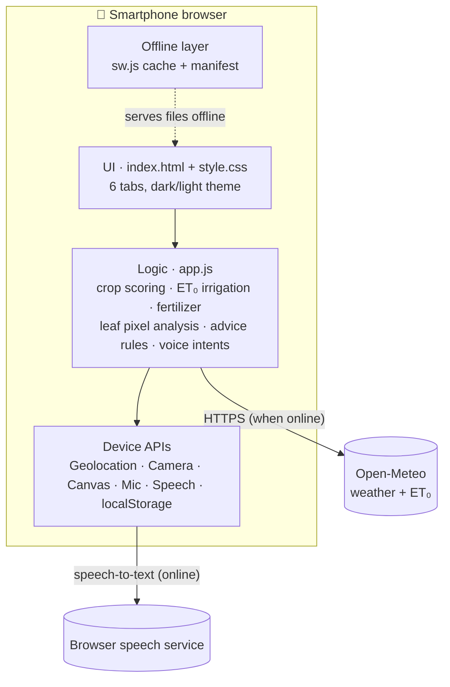

<div align="center">


# 🌾 Smart Agri Assistant

**A pocket crop advisor for farmers: an offline-capable Progressive Web App that turns any smartphone into a field assistant.**
Live weather advice · crop recommendations · leaf health scan · fertilizer & water calculator · farm diary · **voice assistant in 4 Indian languages**

[](https://dc2xx4.github.io/smartphonebla1/)
[](#-testing)
[](#-playwright-guide)


*Built for the subject **Smartphone Computation***

</div>

---

## 📸 Screenshots

<div align="center">
<table>
  <tr>
    <td align="center"><br><sub><b>Home</b>: live GPS weather</sub></td>
    <td align="center"><br><sub><b>Crops</b>: recommender</sub></td>
    <td align="center"><br><sub><b>Voice</b>: ask in 4 languages</sub></td>
    <td align="center"><br><sub><b>Light theme</b>: for sunlight</sub></td>
  </tr>
</table>
<br>
<sub>Desktop layout (screenshots use sample weather data for Chennai)</sub>
</div>

---

## 📑 Contents

- [Why this project](#-why-this-project)
- [Features](#-features)
- [Quick start](#-quick-start)
- [Using the app](#-using-the-app)
- [Testing](#-testing)
- [Playwright guide](#-playwright-guide)
- [How it works](#️-how-it-works)
- [Project structure](#️-project-structure)
- [Deployment](#-deployment)
- [Troubleshooting](#️-troubleshooting)
- [Limitations & future work](#-limitations--future-work)

---

## 💡 Why this project

Small and marginal farmers often lack quick access to hyper-local weather and spray timing, guidance on which crop suits their soil and season, early signs of crop stress, and a simple record of what they did on the field.

Most farmers already own a smartphone, and that phone already has the sensors and processing power needed to help. **Smart Agri Assistant** uses them with **no extra hardware, no app-store install and no account**.

| Smartphone computation idea | How the app uses it |
|---|---|
| 📡 **Sensing** | GPS, camera and microphone act as input sensors |
| 🧠 **Edge computing** | Crop scoring, leaf image analysis and all calculations run on the phone's CPU |
| 📶 **Connectivity-aware** | Uses the network when available and falls back to cached data offline |
| 🔒 **Privacy** | Diary entries and leaf photos never leave the device |
| 📱 **Cross-platform** | One web codebase runs on Android, iOS and desktop, and installs like a native app |

---

## ✨ Features

| | Module | What it does | Device capability |
|---|---|---|---|
| 🌦️ | **Home / Weather** | GPS location, temperature, humidity, wind, rain, 7-day forecast and rule-based advice (skip irrigation, avoid spraying in wind, fungal / frost / heat alerts) | Geolocation API, network ([Open-Meteo](https://open-meteo.com), no API key) |
| 🌱 | **Crop Recommender** | Scores 12 crops out of 100 on soil, pH, season, water and temperature, and shows the top 4 with reasons | On-device computation |
| 🍃 | **Leaf Health Scan** | Measures the share of green, yellow and brown pixels in a leaf photo and gives a health score with a likely cause | Camera + Canvas pixel processing (photo is never uploaded) |
| 🧮 | **Fertilizer & Irrigation** | Daily water need (ET₀ × crop coefficient − rain), and Urea / DAP / MOP quantities for your field area | On-device computation + live ET₀ |
| 📒 | **Farm Diary** | Logs sowing, irrigation, fertilizer, pesticide and harvest with time + GPS stamp; exports to CSV | localStorage, Geolocation |
| 🗣️ | **Voice Assistant** | Ask about weather, crops, water or fertilizer in **English, हिन्दी, தமிழ் or తెలుగు**, and hear the answer spoken back. Typing also works. | Web Speech API (mic → text, needs internet) + speech synthesis |
| 📴 | **Offline & Installable** | Opens with no internet and can be added to the home screen | Service Worker, Web App Manifest |

---

## 🚀 Quick start

### Prerequisites

| Tool | Needed for | Check |
|---|---|---|
| [Python 3](https://www.python.org/downloads/) *or* VS Code Live Server | Serving the app | `python --version` |
| [Node.js 18+](https://nodejs.org) | Running the tests | `node -v` |
| Microsoft Edge (built into Windows) *or* Playwright's Chromium | Playwright tests | – |

### 1. Get the code

```bash
git clone https://github.com/DC2XX4/smartphonebla1.git
cd smartphonebla1
```

> ⚠️ Run **every** command from inside the `smartphonebla1` folder, the one that contains `package.json`.
> Running from the parent folder gives `npm error enoent Could not read package.json`.

### 2. Run the app

```bash
npm run serve            # same as: python -m http.server 8080
```

Then open **http://localhost:8080** in Chrome or Edge.

<details>
<summary><b>Other ways to run it</b></summary>

- **VS Code:** install the **Live Server** extension, then right-click `index.html` → **Open with Live Server**.
- **Any static server:** `npx serve .` works too.

> Always open it through `http://localhost` or `https://`, **not** by double-clicking `index.html`.
> Browsers block GPS, camera, microphone and the service worker on `file://` pages.

</details>

### 3. Install test tools (once)

```bash
npm install
```

This installs **Playwright** (`@playwright/test` 1.56.1). Nothing else is needed: the app itself has **zero dependencies**.

### 4. Run all tests

```bash
npm run test:all         # 54 unit tests + 17 Playwright E2E tests
```

---

## 📱 Using the app

1. **Home**: tap **Use my GPS location** and allow location access. You'll see live weather, advice and a 7-day forecast.
2. **Crops**: choose soil, season and water (pH slider optional) and tap **Recommend crops**.
3. **Leaf**: take or upload a photo of a leaf in daylight to get a health score.
4. **Calc**: pick a crop, field area and growth stage to get water (litres/day) and fertilizer (kg).
5. **Diary**: save an activity with a note; it's stamped with time + GPS. Use **Export CSV** to download it.
6. **Voice**: pick a language, tap 🎤 and ask, e.g. *"How much water for rice?"*, *"गेहूं के लिए खाद बताओ"*, *"இன்று வானிலை எப்படி?"*, *"ఏ పంట వేయాలి?"*. You can also tap an example or type your question.
7. **Install**: on a phone, open the live demo → browser menu → **Add to Home screen**.

> 🔊 **Not hearing Tamil or Telugu?** Your device has no voice installed for that language, so the answer is shown as text.
> Use **Microsoft Edge** (it includes online Tamil/Telugu voices), an **Android phone**, or add the voice in
> *Windows Settings → Time & language → Speech*.

---

## 🧪 Testing

This project includes **Milestone 3: Tool-based Software Test Automation & Documentation**.

| Suite | Tool | Tests | Command | Time |
|---|---|---:|---|---|
| Unit: calculation engine + voice classifier | Node.js built-in test runner (`node:test`, xUnit / JUnit style) | **54** | `npm test` | ~0.1 s |
| End-to-end: real browser, phone emulation | **Playwright** + Microsoft Edge | **17** | `npm run test:e2e` | ~20 s |
| **Total** | | **71 ✅** | `npm run test:all` | |

**Techniques used:** Boundary Value Analysis · Equivalence Partitioning · Decision Tables · Use-case & state-transition testing · Error guessing · Security (XSS) testing · Control-flow graph & cyclomatic complexity · Taint analysis.

### 📄 Test documentation

| Document | What's inside |
|---|---|
| [01 · Test Plan](docs/testing/01-test-plan.md) | Scope, approach, environment, entry/exit criteria, risks |
| [02 · Test Cases](docs/testing/02-test-cases.md) | 71 automated + 5 manual cases with inputs, expected and actual results |
| [03 · Bug Report](docs/testing/03-bug-report.md) | 4 real defects found (stored XSS, negative field area, stale cache, season labels) |
| [04 · RTM](docs/testing/04-rtm.md) | 17 requirements ↔ test cases, forward & backward traceability |
| [05 · Test Summary](docs/testing/05-test-summary.md) | Results, defect status, exit-criteria check |
| [06 · Black-box & Code Analysis](docs/testing/06-blackbox-code-analysis.md) | EP, BVA, decision table, CFG, V(G), taint analysis |
| [Exam Demo Script](docs/testing/EXAM-DEMO.md) | 5-minute step-by-step demonstration |
| [Evidence](docs/testing/evidence/) | Raw console output of the test runs |

---

## 🎭 Playwright guide

[Playwright](https://playwright.dev) controls a **real browser** with code. In this project it opens the app in **Microsoft Edge emulating a Pixel 5 phone**, taps buttons and fills in forms like a farmer would, and checks that the right results appear.

### What the 17 E2E tests cover

| Area | Tests | How Playwright makes it testable |
|---|---|---|
| App load, tabs, offline mode | TC-42, TC-53 | `context.setOffline(true)` cuts the network |
| GPS weather + advice | TC-43 | `geolocation` option fakes the GPS position |
| Crop recommender, calculator | TC-44 – TC-46 | Fills forms, asserts exact numbers |
| Diary + CSV export | TC-47, TC-49 | Captures the downloaded file and reads it |
| Security (XSS) | TC-48, TC-71 | Types an attack payload and checks it is not executed |
| Leaf scan | TC-50 | Generates a green PNG and uploads it |
| Failure handling | TC-51, TC-52, TC-70 | Weather API returns HTTP 500; GPS denied; no speech support |
| Voice assistant (4 languages) | TC-67 – TC-69 | Fake microphone "hears" a sentence; records what the app speaks |

The weather API is stubbed with `page.route()` and GPS is fixed, so **results are identical on every run**.

### Commands

```bash
# Check Playwright is installed
npx playwright --version          # → Version 1.56.1
npx playwright test --list        # → Total: 17 tests in 1 file

# Run the tests
npx playwright test                           # headless (fast)
npx playwright test --headed --workers=1      # watch a real browser click through the app
npx playwright test -g "TC-48"                # run one test by name or ID
npx playwright test --ui                      # interactive UI mode with time-travel debugging

# See the results
npx playwright show-report                    # HTML report with a screenshot of every test
```

> 💡 You don't need to start the app first. [`playwright.config.js`](playwright.config.js) starts
> `python -m http.server 8080` automatically, or reuses it if it's already running.

### Configuration at a glance

```js
// playwright.config.js
projects: [{ name: 'Mobile (Pixel 5) – Edge', use: { ...devices['Pixel 5'], channel: 'msedge' } }],
use:       { baseURL: 'http://localhost:8080', screenshot: 'on', trace: 'retain-on-failure' },
webServer: { command: 'python -m http.server 8080', url: 'http://localhost:8080', reuseExistingServer: true },
```

<details>
<summary><b>No Microsoft Edge on this computer? (macOS / Linux / lab PCs)</b></summary>

Use Playwright's own Chromium instead:

```bash
npx playwright install chromium
```

Then in `playwright.config.js` remove `channel: 'msedge'` from the project's `use` block.

</details>

<details>
<summary><b>Example: a Playwright test from this project</b></summary>

```js
test('TC-45 calculator: Wheat, 2 acres, mid season → Urea 168, DAP 104, MOP 53 kg', async ({ page }) => {
  await tab(page, 'Calc');
  await page.selectOption('#calcCrop', 'Wheat');
  await page.fill('#area', '2');
  await page.click('#btnCalc');
  await expect(page.locator('#calcResult')).toContainText('Urea: 168 kg');
  await expect(page.locator('#calcResult')).toContainText('DAP: 104 kg');
});
```

</details>

### 🔁 Prove a test really catches a bug

1. In `app.js`, inside `renderLog`, change `${escapeHTML(x.note)}` back to `${x.note}`.
2. Run `npx playwright test -g TC-48` → it **fails** (the note is turned into a real `` element).
3. Undo the change and run it again → it **passes**.

---

## ⚙️ How it works

### Architecture



### Algorithms

<details>
<summary><b>🌱 Crop recommendation: score out of 100</b></summary>

| Factor | Max points |
|---|---:|
| Temperature within the crop's ideal range (−5 points per °C outside) | 30 |
| Soil pH within range (partial credit nearby) | 20 |
| Soil type suits the crop | 20 |
| Crop belongs to the season (Kharif / Rabi / Zaid, auto-detected from the date) | 20 |
| Water availability meets crop demand | 10 |

</details>

<details>
<summary><b>🍃 Leaf health scan</b></summary>

Each pixel is classified by RGB: **green** = healthy, **yellow** = possible chlorosis (N/Fe deficiency, overwatering), **brown** = possible necrosis or disease spots. Dark, white and grey pixels (soil, sky, background) are ignored.

```
Health score = 100 − (yellow% + 1.5 × brown%)
```

*This is a screening heuristic, not a trained disease classifier.*

</details>

<details>
<summary><b>💧 Irrigation</b></summary>

```
Water need (mm/day) = max(0, ET₀ × Kc − 0.8 × expected rain)
Litres/day          = mm/day × 4046.86 × acres
```

ET₀ (reference evapotranspiration) comes from the weather API. Kc is the crop coefficient for the growth stage.

</details>

<details>
<summary><b>🧪 Fertilizer</b></summary>

Nutrient targets (N, P₂O₅, K₂O in kg/acre) are converted into products:
**DAP** (18 % N, 46 % P₂O₅) covers phosphorus → **Urea** (46 % N) covers the remaining nitrogen → **MOP** (60 % K₂O) covers potassium.

</details>

<details>
<summary><b>🗣️ Voice assistant</b></summary>

1. The browser's `SpeechRecognition` turns speech into text in the chosen language (`en-IN`, `hi-IN`, `ta-IN`, `te-IN`). **This step needs internet**, because Chrome and Edge use Google's and Microsoft's speech servers.
2. `classifyVoiceIntent()` matches keywords in all 4 languages to an intent (weather, crop, water, fertilizer or leaf) and spots any crop name mentioned.
3. `processVoiceCommand()` answers using the **same on-device functions** as the other tabs, so the voice answer always matches the Calc tab.
4. `speechSynthesis` speaks the reply in the chosen language. If no voice is installed, the answer is shown as text.

</details>

---

## 🗂️ Project structure

```
smartphonebla1/
├── index.html                  # UI: 6 tabs (Home, Crops, Leaf, Calc, Diary, Voice)
├── style.css                   # Design system: dark/light themes, glass cards, dock nav
├── app.js                      # All logic: crops, leaf scan, calculators, diary, voice
├── sw.js                       # Service worker (offline cache)
├── manifest.webmanifest        # PWA install metadata
├── icon.svg                    # App icon
├── package.json                # npm scripts + Playwright dev dependency
├── playwright.config.js        # E2E config: Edge, Pixel 5, auto-start server
├── tests/
│   ├── unit/logic.test.js      # 54 unit tests (node:test)
│   └── e2e/app.spec.js         # 17 Playwright end-to-end tests
├── docs/
│   ├── testing/                # Test plan, cases, bugs, RTM, summary, analysis, demo
│   │   └── evidence/           # Saved test-run output
│   └── screenshots/            # Images used in this README
├── backup/v1-original-ui/      # Original plain UI (see below to revert)
└── .github/workflows/pages.yml # Auto-deploy to GitHub Pages on push to main
```

### npm scripts

| Script | What it does |
|---|---|
| `npm run serve` | Serve the app at http://localhost:8080 |
| `npm test` | Run the 54 unit tests |
| `npm run test:e2e` | Run the 17 Playwright tests |
| `npm run test:all` | Run everything |
| `npm run report` | Open the last Playwright HTML report |

<details>
<summary><b>↩️ Revert to the original plain design</b></summary>

```bash
# Windows
copy backup\v1-original-ui\index.html index.html
copy backup\v1-original-ui\style.css style.css
# macOS / Linux
cp backup/v1-original-ui/index.html backup/v1-original-ui/style.css .
```

Reload twice. Note that the original UI has no Voice tab, so the voice E2E tests will fail with it.

</details>

---

## 🌐 Deployment

Every push to `main` triggers [`.github/workflows/pages.yml`](.github/workflows/pages.yml), which publishes the folder to **GitHub Pages**: https://dc2xx4.github.io/smartphonebla1/

> When you change any app file, bump the cache name in `sw.js` (`agri-v4` → `agri-v5`).
> Otherwise phones that already installed the app keep showing the old version.

---

## 🛠️ Troubleshooting

| Problem | Fix |
|---|---|
| `npm error enoent Could not read package.json` | You're in the wrong folder. `cd smartphonebla1` first. |
| GPS / camera / mic don't work | Open via `http://localhost:8080`, not `file://`, and allow the permission prompt. |
| Changes don't show up | Press **Ctrl + Shift + R**, or reload twice (the service worker serves the cached copy first). |
| Playwright: `browserType.launch` error for Edge | Run `npx playwright install chromium` and remove `channel: 'msedge'` from the config. |
| Port 8080 already in use | Stop the other server, or change the port in `package.json` and `playwright.config.js`. |
| Voice answer is text only | No voice for that language on this device. Use Edge or Android (see [Using the app](#-using-the-app)). |
| Mic says "needs internet" | Speech-to-text is online-only in Chrome/Edge. Typing questions works offline. |

---

## 🧭 Limitations & future work

**Limitations**
- Leaf analysis uses colour thresholds, so lighting and background affect the result.
- Fertilizer doses are typical values, not based on a soil test.
- The crop list covers 12 common crops.
- Voice recognition needs internet; spoken output depends on the voices installed on the device.

**Future work**
- On-device TensorFlow.js disease model to replace the colour heuristic.
- Soil-moisture / IoT sensor input over Web Bluetooth.
- Market (mandi) price tracking and push notifications for weather alerts.
- Optional cloud sync for the diary.
- Run the test suite in GitHub Actions before every deploy.

---

## ⚠️ Disclaimer

Advice is for guidance only. Confirm fertilizer, pesticide and crop decisions with your local agriculture officer.

## 👤 Author

**Dharshini Chellam**

<div align="center">
<sub>Made with 🌱 for farmers, using only the web platform: no frameworks, no build step.</sub>
</div>
